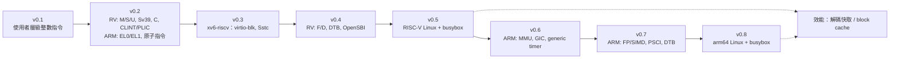

# 路線圖：讓 RISC-V 與 ARM 都能跑 Linux

一版一版往前推進，每一版都用 QEMU 當參考答案驗證。

| 版本 | RISC-V | AArch64 | 驗收 |
|---|---|---|---|
| v0.1 | RV64IMA（M-mode） | A64 整數子集 | gcc 編譯的 C 程式、與 qemu-user 指令級比對 |
| v0.2 | M/S/U、委派、Sv39、C、CLINT、PLIC | EL0/EL1 例外、LDXR/STXR、LSE、CAS | 與 qemu-system 輸出逐位元組相同 |
| v0.3 | virtio-blk、Sstc、批次執行 | — | xv6 開機到 shell、usertests |
| v0.4 ✅ | F/D 浮點（位元精確 softfloat）、device tree 產生器、內建 SBI、可載入 OpenSBI (`-bios`) | — | 與 qemu-system 逐位元比對；OpenSBI 在 ruvm 上開機 |
| v0.5 ✅ | SBI PMU、initramfs 載入、`-send-after` 腳本化輸入 | — | Debian riscv64 Linux 開機到 busybox shell |
| v0.6 ✅ | — | MMU（4K granule、48-bit VA、TTBR0/1）、GICv2、generic timer、PL011 中斷、純量 FP + NEON（約 2000 組與 QEMU 比對）、PSCI、DTB | Debian arm64 Linux 開機到 busybox shell |
| v0.7 | — | FP 估計指令、CRC32/crypto、`virtio-net` | — |
| v0.8 | — | 多核心（PSCI CPU_ON） | `-smp 2` 開機 |

**兩種架構的 Linux 在 v0.6 都已能開機。** 後續版本（v0.7+）是改善：真正的根檔案系統（virtio-blk 上的 ext4）、網路、多核心。

效能是跨版本的工作：Linux 開機需要數十億個指令，目前純直譯約 100 MIPS；
加入解碼快取（每個指令只解碼一次）預期可快 2–3 倍。
