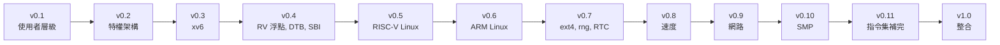

# 路線圖

目標：RISC-V 與 ARM 都能跑 Linux。**v0.6 達成，v1.0 完成整合。** 每一版都用 QEMU 當參考答案驗證。

| 版本 | 內容 | 文件 |
|---|---|---|
| v0.1 | RV64IMA、A64 整數 | — |
| v0.2 | RISC-V M/S/U、Sv39、C、CLINT/PLIC；ARM EL0/EL1、原子指令 | [v0.2](v0.2.md) |
| v0.3 | virtio-blk、Sstc；xv6 開機 | [v0.3](v0.3.md) |
| v0.4 | F/D 位元精確浮點、DTB、SBI、OpenSBI | [v0.4](v0.4.md) |
| v0.5 | RISC-V Debian Linux 開機到 shell | [v0.5](v0.5.md) |
| v0.6 | ARM MMU、GICv2、timer、FP/NEON、PSCI；ARM Debian Linux | [v0.6](v0.6.md) |
| v0.7 | ext4 根、virtio-rng、RTC、重開機 | [v0.7](v0.7.md) |
| v0.8 | 速度（類別式解碼、批次執行） | [v0.8](v0.8.md) |
| v0.9 | virtio-net、使用者模式網路 | [v0.9](v0.9.md) |
| v0.10 | SMP，最多 8 核 | [v0.10](v0.10.md) |
| v0.11 | FP 估計、CRC32、AES、SHA、CASP；RISC-V B、Zicond、Zicbo*、Svinval、Sv48、PMP | [v0.11](v0.11.md) |
| v1.0 | CI 腳本、清理、文件 | [v1.0](v1.0.md) |

## 1.0 之後

1. **速度**：預解碼快取／基本區塊，之後再考慮 JIT（目前上限約 120 MIPS）。
2. **指令集**：RISC-V V、H；ARM EL2、SVE、PAuth。
3. **裝置**：GICv3、PCI、virtio-gpu / input、9p。
4. **真正的多執行緒 SMP**。
