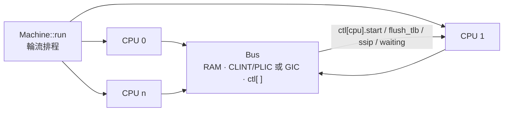

# ruvm v0.10：多核心（`-smp N`）

兩種架構都支援 1–8 個 CPU：RISC-V 的 hart、ARM 的核心。Linux（Debian riscv64 / arm64）與 xv6 都能以多核心開機並平行執行工作。

```
$ ruvm -M aarch64 -smp 4 ...
smp: Brought up 1 node, 4 CPUs
~ # nproc
4
```

## 排程模型

所有 CPU 在**同一個主機執行緒**上輪流執行（`Machine::run`）：每個 CPU 跑一個 quantum（512 個指令；單核心仍是 4096），
睡眠（WFI）或已關機的 CPU 會被跳過；全部閒置時板子時鐘直接跳到最早的喚醒時間。

* **決定性**：同一個程式每次輸出相同，容易除錯與比對。
* **記憶體模型**：一次只有一個 CPU 在執行，所以天然循序一致；不需要任何同步原語。
* **原子序列**：`LR…SC` / `LDXR…STXR` 序列不會在中間被切換給另一個 CPU（quantum 用完時，若有獨占監視器就繼續跑到序列結束，最多 64 個指令）。
* **時間**：每個 CPU 的 k 個指令只算 `k/ncpus` 個 tick，所以模擬時間不會因為 CPU 數而變快。
  （第一版沒做這件事：Linux 的 watchdog 回報「CPU#2 stuck for 45s」，其實是時間過得太快。）
* 睡眠中的 CPU 由 `Bus::ctl[cpu]` 標記（`parked` / `waiting` / `start` / `flush_tlb` / `ssip`），這是 CPU 之間唯一的溝通管道。



## RISC-V

| 項目 | 說明 |
|---|---|
| `mhartid` | 每個 hart 自己的編號 |
| CLINT | 每個 hart 一組 `msip` / `mtimecmp` |
| PLIC | 每個 hart 兩個 context（M = 2·h，S = 2·h+1） |
| SBI HSM | `hart_start` / `hart_stop` / `hart_get_status` / `hart_suspend`（保留式）；內建 SBI 啟動時只有 hart 0 運行，其餘停放，等 Linux 呼叫 `hart_start` |
| SBI IPI / RFENCE | 對目標 hart 設定 SSIP / 要求清 TLB（`ctl[h].ssip` / `flush_tlb`） |
| 韌體路徑 | `-bios` 時所有 hart 從韌體入口開始（`a0` = hartid），OpenSBI 自己用 CLINT msip 與 HSM 喚醒其他 hart |
| 裸機 | 與 QEMU `-bios none` 相同：所有 hart 同時從入口開始 |

## ARM

| 項目 | 說明 |
|---|---|
| `MPIDR_EL1` | Aff0 = CPU 編號 |
| GICv2 | 重寫成多 CPU：SGI/PPI 每個 CPU 一份（banked），SPI 共用並依 `ITARGETSR` 分送；`GICD_SGIR` 的 target list / filter、SGI 來源 CPU（`IAR[12:10]`）、每個 CPU 介面各自的 `CTLR/PMR/BPR/IAR/EOIR`。單核心時 SPI 預設送給 CPU 0（和 QEMU 一樣）。 |
| PSCI | `CPU_ON`（含 `INVALID_PARAMS` / `ALREADY_ON` / `ON_PENDING`）、`CPU_OFF`、`AFFINITY_INFO`、`PSCI_FEATURES`、版本 1.1 |
| 定時器 | `CNTV`/`CNTP` 每個 CPU 各自一份，PPI 也是 banked |
| TLBI | 廣播：同時要求其他 CPU 清 TLB |
| WFE / YIELD | 結束目前 quantum，讓其他 CPU 先跑（自旋鎖不會空轉整個 quantum） |
| 開機 | 只有 CPU 0 運行；其餘關機，等 PSCI `CPU_ON`（進入點、`x0` = context id、EL1、MMU 關閉） |

device tree 依 CPU 數產生（RISC-V 每個 hart 一個 `cpu@h` 與 interrupt-controller、CLINT/PLIC 的 `interrupts-extended`；
ARM 每個核心一個 `cpu@c`，arch timer 的 CPU mask）。

## 驗證

* `rv_smp`、`a64_smp`：四個 CPU 的差分測試（輸出與 QEMU `-smp 4` 逐位元組相同，而且每次執行都相同）。
  * RISC-V：4×1000 次 `amoadd`、4×400 次 `lr/sc` 自旋鎖保護的非原子遞增、CLINT 軟體中斷互相通知。
  * ARM：PSCI 錯誤碼與版本、`ldxr/stxr` 與 `ldadd` 計數、`ldaxr/stlr` + `wfe/sev` 自旋鎖、SGI（target list / 全部其他 / 自己）與來源 CPU、廣播 TLBI。
* xv6 在 2 個 hart 上開機並可使用；手動驗證 4 個 hart 也可以（`forktest` 通過）。
* `linux_smp_{riscv64,aarch64}`（`--ignored`）：Linux 以 4 個 CPU 開機，`nproc` = 4，四個平行工作完成，沒有 RCU stall 或 soft lockup，正常關機。

## 限制

* 不是真的平行：速度與單核心相同（總共約 120 MIPS 分給所有 CPU），多核心用來測試正確性，不是加速。
* 沒有 NUMA、沒有 CPU 效能差異；所有 CPU 都是同一種。
* CPU 熱插拔（`hart_stop` / `CPU_OFF` 之後再啟動）有基本支援，但沒有在 Linux 上壓力測試。
