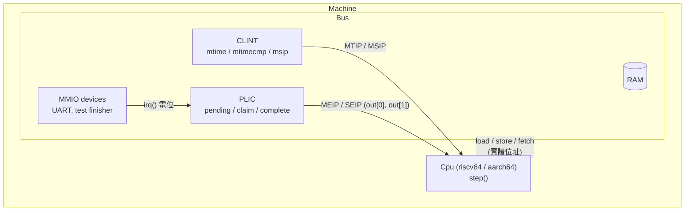
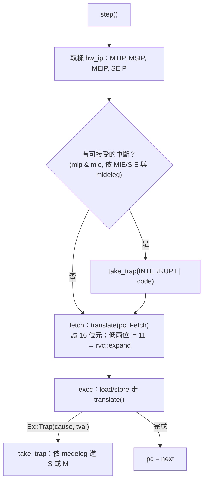
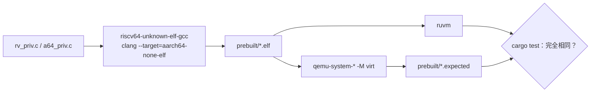

# ruvm v0.2 設計說明

v0.1 只能跑「裸機 + M-mode / EL1」的使用者層級程式。v0.2 的目標是補上作業系統核心需要的
系統層級功能，並且用 QEMU 作為黃金參考：同一個 ELF 在 `qemu-system-*` 和 ruvm 上跑，
console 輸出必須逐位元組相同。

## 新功能總覽

| 項目 | RISC-V 64 | AArch64 |
|---|---|---|
| 特權模式 | M / S / U，`mret` / `sret` | EL0 / EL1，`eret` |
| 例外委派 | `medeleg` / `mideleg` | — (全部進 EL1) |
| 例外向量 | `mtvec` / `stvec`（direct / vectored） | `VBAR_EL1`，16 個向量 |
| 狀態暫存器 | `mstatus` / `sstatus`：MPRV、SUM、MXR、TVM、TW、TSR | `SPSR_EL1`、`ELR_EL1`、`ESR_EL1`、`FAR_EL1`、DAIF、SPSel、`SP_EL0` |
| 虛擬記憶體 | Sv39，硬體更新 A/D 位元，256 項 TLB | (尚未) |
| 中斷 | CLINT（`mtime`/`mtimecmp`/`msip`）+ PLIC（127 個來源，M/S 兩個 context） | (尚未，DAIF 只是儲存) |
| 指令集 | 新增 C（壓縮指令） | 新增 LDXR/STXR/LDXP/STXP、LDAR/STLR、LSE（LDADD…/SWP/CAS）、CLREX |
| 計時器 | `time` CSR = `mtime` | `CNTVCT_EL0` / `CNTPCT_EL0` = `mtime`，`CNTFRQ_EL0` = 10 MHz |

## 架構

* **Bus** 擁有 CLINT 與 PLIC（它們不是一般 `Device`，因為 CPU 每一步都要讀它們的輸出線）。
* 每個 `Device` 新增 `irq()`，回傳中斷線電位；`Bus::map_irq` 把裝置接到某個 PLIC 來源。
  每次存取這類裝置後 `Bus::poll_irqs()` 會重新取樣；互動模式 (`-serial stdio`) 下每 4096 個指令也會取樣一次，以接收鍵盤輸入。
* PLIC 的 gateway 行為與 QEMU 一致：電位為高時鎖存 pending，只有 claim 會清除。
* 時間基準：每執行一個指令 `mtime += 1`，所以模擬是**決定性的**（同一程式每次輸出相同）。
  `WFI` 若沒有待處理中斷，`Bus::idle()` 會直接把時間跳到下一個 `mtimecmp`。

## RISC-V：一個指令的生命週期

### 中斷優先順序與致能

$$
\text{pending} = (\text{mip}_{sw} \;|\; \text{mip}_{hw}) \;\&\; \text{mie}
$$

* 未委派的中斷（`~mideleg`）在 `prv < M` 或 `mstatus.MIE = 1` 時可被接受。
* 委派的中斷（`mideleg`）在 `prv < S` 或 (`prv = S` 且 `SIE = 1`) 時可被接受；在 M-mode 永遠不會被接受。
* 同時發生時依 MEI, MSI, MTI, SEI, SSI, STI 的順序選擇。

### Sv39 位址轉換

虛擬位址 $va$ 必須是 39 位元的正規形式（bit 63..39 等於 bit 38），否則產生 page fault。
三層頁表索引為 $vpn_i = (va \gg (12 + 9i)) \,\&\, \texttt{0x1ff}$，$i = 2, 1, 0$。

* 有效特權：資料存取若 `MPRV = 1`，使用 `mstatus.MPP`；取指令永遠用目前特權。
* 權限檢查：U 頁只有 U-mode 可用；S-mode 存取 U 頁需要 `SUM`，且永遠不能執行 U 頁；
  `MXR` 讓「只可執行」的頁也能讀。
* A/D 位元由硬體設定（與 QEMU 的 Svadu / `menvcfg.ADUE` 行為相同）。
* TLB：256 項直接對映，記錄 4 KiB 頁的實體頁號與葉節點 PTE 旗標；權限在每次命中時重新檢查，
  所以改變 `prv`、`SUM`、`MXR` 不需要清 TLB。寫入時若快取的 PTE 沒有 D 位元則重走頁表。
  寫 `satp` 或執行 `sfence.vma` 時整個清空。
* 跨頁的非對齊存取會逐位元組轉換，store 會先轉換全部位元組再寫入，避免寫一半就 fault。

## AArch64：例外

| 來源 | EC | `ELR_EL1` | 向量偏移 |
|---|---|---|---|
| `SVC #imm` | `0x15` | 下一個指令 | |
| `BRK #imm` | `0x3c` | 該指令 | 同 EL、SP0：`0x000` |
| 未定義指令 | `0x00` | 該指令 | 同 EL、SPx：`0x200` |
| data abort（bus error） | `0x24` / `0x25` | 該指令 | 低 EL (AArch64)：`0x400` |
| instruction abort | `0x20` / `0x21` | 該指令 | |

進入例外時：`SPSR_EL1 = NZCV | DAIF<<6 | EL<<2 | SPSel`，DAIF 全部遮蔽，切到 EL1h（SP_EL1）。
`ERET` 依 `SPSR_EL1` 還原，並清除 exclusive monitor。

為了相容 v0.1 的裸機程式：只要 `VBAR_EL1 == 0`，`SVC` 仍是 host syscall，其他例外則直接停止模擬並印出原因。

## 驗證方法

`tests/guest/build_sys.sh` 重新編譯並更新參考輸出。測試內容：

* **rv_priv**：M-mode 設定 PMP、委派，`mret` 進 S-mode；S 建立 Sv39 頁表（裝置 gigapage、RAM 恆等對映、
  高位唯讀別名、U 程式頁、只可執行頁），測試 non-canonical / 唯讀 / SUM / MXR / S 執行 U 頁等 page fault，
  `ebreak` 與非對齊 AMO 不委派而進 M；進入 U-mode 執行 syscall、page fault、非法指令、AMO；
  檢查 A/D 位元；SSIP 軟體中斷、經 M 轉發的 S 計時器中斷 (STIP)、M 軟體中斷 (CLINT msip)、
  以及 UART THRE 中斷經 PLIC 送到 S-mode 的 claim / complete。
* **a64_priv**：EL1 下的 SVC/BRK/UDF/讀寫 data abort、SPSel=0 時走 SP0 向量、DAIF、NZCV、
  LSE（LDADD/LDCLRAL/LDEOR/STSET/SWPAL/LDSMAX/LDUMIN/LDUMAX）、CAS/CASAL、LDXR/STXR/CLREX/LDXP/STXP/LDAR/STLR；
  再 `eret` 到 EL0 測試 syscall、存取 EL1 暫存器 (UNDEFINED)、EL0 data abort、EL0 的 LDXR/STXR。

### 與 QEMU 刻意不同之處

* RISC-V 非對齊 AMO：規格要求 store/AMO misaligned (cause 6)，QEMU 10 回報 cause 4。ruvm 依規格；測試兩者都接受。
* QEMU 的 `mideleg` 會強制設定 hypervisor 相關位元；測試只印出 SSI/STI/SEI 三個位元。

## 下一步 (v0.3 候選)

* RISC-V：device tree (DTB) + SBI，才能啟動 OpenSBI / Linux；virtio-mmio block 以啟動 xv6；F/D 擴充。
* AArch64：MMU（4 KiB granule, 48-bit VA）、GICv2 + generic timer 中斷。
* 效能：目前約 100 MIPS（純直譯），可加入解碼快取或 basic-block 快取。
