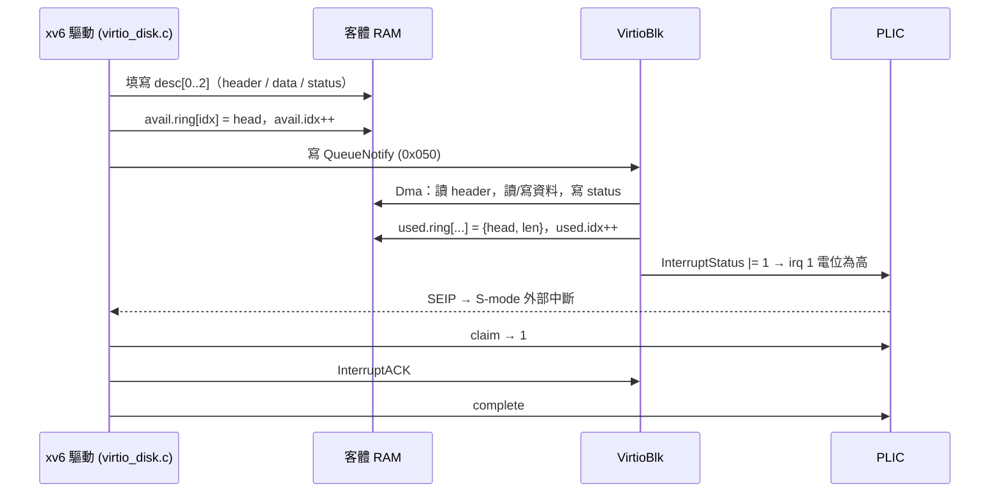

# ruvm v0.3：啟動 xv6-riscv

v0.3 的目標是讓 MIT 的教學作業系統 [xv6-riscv](https://github.com/mit-pdos/xv6-riscv)
在 ruvm 上開機到 shell，並通過它自己的 `usertests`。這是邁向 Linux 的第一個「真正的核心」：
它會用到分頁、行程切換、計時器中斷、PLIC 外部中斷、UART 收發中斷，以及磁碟 DMA。

```
$ ruvm -M riscv64 -m 128 -kernel tests/guest/prebuilt/xv6/kernel \
       -drive file=tests/guest/prebuilt/xv6/fs.img -snapshot -serial stdio

xv6 kernel is booting

init: starting sh
$ ls
.              1 1 1024
..             1 1 1024
README         2 2 2441
...
```

## 新增功能

| 項目 | 說明 |
|---|---|
| virtio-mmio 區塊裝置 | `src/virtio.rs`：version 2（modern）介面，一個 split virtqueue，支援 IN / OUT / FLUSH / GET_ID 請求。位址 `0x1000_1000`，PLIC 中斷 1（與 QEMU `virt` 第一個 virtio 槽相同）。 |
| DMA | `Device::dma(&mut Dma)`：每次寫入裝置暫存器後呼叫，裝置透過 `Dma` 直接讀寫客體 RAM。 |
| Sstc | `stimecmp` CSR（`0x14d`）：`menvcfg.STCE = 1` 時 `mip.STIP = (time >= stimecmp)`；S-mode 存取需要 `STCE` 與 `mcounteren.TM`。新版 xv6 用它取代 M-mode 計時器轉發。 |
| WFI 快轉 | 閒置時時間直接跳到 `min(mtimecmp, stimecmp)`。 |
| 命令列 | `-drive file=img[,...]`（接受 QEMU 語法）、`-snapshot`（寫入只留在記憶體）、`-input "ls\n"`（開機時在 console 打字，方便腳本化測試）。 |
| 效能 | CPU 以 4096 個指令為一批執行（`Cpu::run`）；取指令快速路徑（快取目前程式頁在 RAM 中的位移）；C 指令展開改為查 64K 表。 |

### virtio 請求流程



## 測試

* `xv6_boots_and_runs_shell_commands`：用 `-input` 輸入 `echo`、`mkdir`、重新導向、管線、`ls`，
  檢查輸出。磁碟使用 `-snapshot`，所以 `prebuilt/xv6/fs.img` 不會被修改。
* `tests/guest/build_xv6.sh` 會下載固定版本（commit `e93dabe`）的 xv6 並重新產生 `kernel` 與 `fs.img`。
* `Cargo.toml` 的 dev profile 改為 `opt-level = 2`：模擬器不最佳化就太慢了，但保留 overflow 檢查，
  所以 `cargo test` 同時也是溢位檢查。

## 注意事項

* xv6 開機時 `kinit()` 會逐位元組 `memset` 整個 128 MiB，大約 4.5 億個指令，所以在 ruvm 上需要幾秒鐘。
* 時間基準是「每個指令 1 tick」，閒置時直接快轉，所以 xv6 的 `ticks` 不是真實時間；
  互動模式 (`-serial stdio`) 下閒置會真的睡眠，以便接收鍵盤輸入。
* 只模擬一個 hart；xv6 的 `NCPU` 是上限，不需要每個 CPU 都存在。
