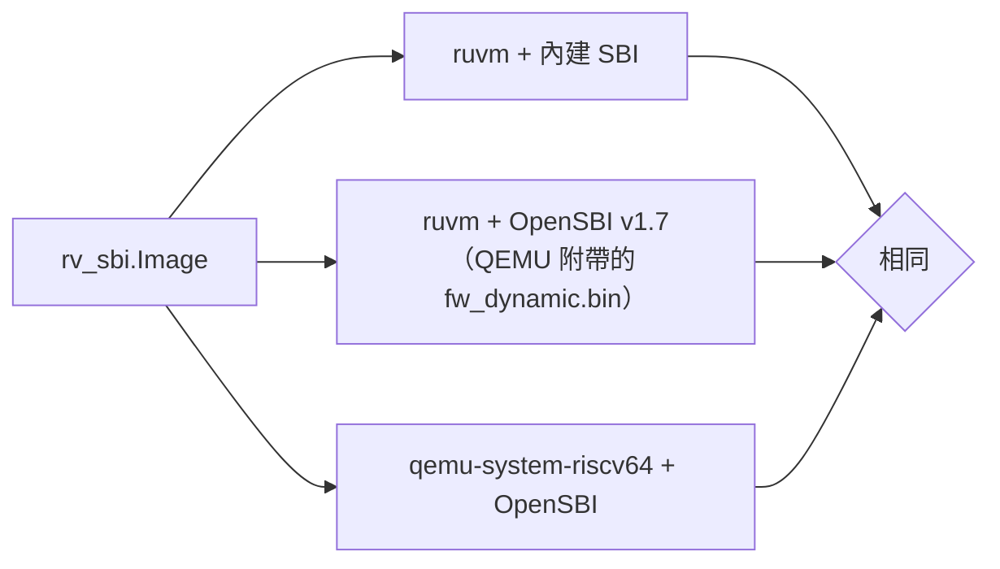

# ruvm v0.4：F/D 浮點、device tree、SBI 與 Linux 開機協定

v0.4 補齊 RISC-V Linux 需要、但 xv6 不需要的部分。

| 項目 | 說明 |
|---|---|
| F/D 擴充 | `src/cpu/softfloat.rs`：位元精確的 IEEE 754 單/雙精度運算，五種捨入模式與五個例外旗標。`f` 暫存器做 NaN-boxing，`fcsr`/`frm`/`fflags`，`mstatus.FS` 與 `SD` 的 dirty 追蹤，壓縮指令 `C.FLD/C.FSD/C.FLDSP/C.FSDSP`。 |
| Device tree | `src/fdt.rs`：產生與 QEMU `virt` 相同結構的 DTB（cpu、cpu-intc、CLINT、PLIC、UART、virtio、syscon 關機/重開機）。`-dumpdtb` 可輸出檢查。 |
| 內建 SBI | 沒有 `-bios` 時，ruvm 直接以 S-mode 啟動核心，並在模擬器內處理 `ecall`：BASE、TIME、IPI、RFENCE、HSM、SRST、DBCN 與 legacy 呼叫。 |
| OpenSBI | `-bios fw_dynamic.bin`：照 QEMU 的方式（`a0`=hartid、`a1`=DTB、`a2`=`fw_dynamic_info`）以 M-mode 執行真正的 OpenSBI。 |
| Linux 開機協定 | `-kernel Image`（偵測 `RSC\x05` magic）、`-initrd`、`-append`。核心放在 RAM + `text_offset`，DTB 在 RAM 頂端下 1 MiB，initrd 緊接在 DTB 下方。 |

## 軟體浮點的做法

每個運算都先把運算元拆成整數有效位數 $m$ 與指數 $e$（值為 $m \cdot 2^e$），
用 `u128` 算出**精確**結果，或「精確結果 + sticky 位元」，最後只在 `round_pack` 捨入一次：

$$
\text{result} = \operatorname{round}_{rm}\!\left( (-1)^s \cdot m \cdot 2^{e} \right)
$$

* 加減法：兩數都左移到第 125 位對齊，較小者右移時把移出的位元 OR 到最低位（sticky）。
* 乘法：$m_a m_b$ 最多 106 位元，直接精確。
* 除法：被除數左移到第 126 位、除數到第 63 位，商約 63 位元，餘數不為零就設 sticky。
* 平方根：整數平方根，餘數不為零就設 sticky。
* FMA：乘積（精確）與加數用和加法相同的對齊方式相加，只捨入一次。
* 依 RISC-V 規定：NaN 結果一律是 canonical NaN；tininess 在捨入**之後**判定。

驗證：

* 單元測試：20 萬組隨機位元樣式（偏向次正規數、極大值、NaN、無限大），
  加/減/乘/除/平方根/FMA/轉換與主機 FPU 的 round-to-nearest 結果逐位元比對。
* `rv_fp`：48 組指令 × 特殊運算元 × 5 種捨入模式，結果位元與 `fflags` 的雜湊和 `qemu-system-riscv64` 完全相同。

## SBI 三方比對

`rv_sbi.S` 是一個帶 Linux Image header 的 S-mode 小程式：印字（legacy putchar）、讀 DTB magic、
查詢 SBI 版本與擴充、DBCN 寫字串、用 `set_timer` 等計時器中斷、查 HSM 狀態、最後用 SRST 關機。
以下三種組合的輸出逐位元組相同：

能在 ruvm 上跑 OpenSBI，代表 M-mode 的大部分行為（CSR 探測與陷阱、PMP CSR、CLINT、委派、
`mret` 進 S-mode）都和 QEMU 夠一致。
