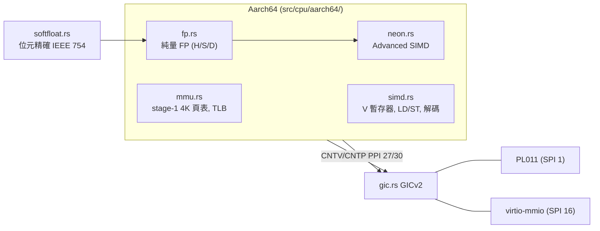

# ruvm v0.6：AArch64 Linux

v0.6 讓 **Debian 13 的原廠 arm64 核心**（Linux 6.12 `debian-installer` netboot 映像）在 ruvm 上開機到
busybox shell、執行指令並透過 PSCI 正常關機。至此 RISC-V（v0.5）與 ARM 兩種架構都能跑 Linux。

```
$ tools/linux/fetch-debian.sh arm64
$ ruvm -M aarch64 -m 1024 -kernel tests/guest/out/linux/debian/arm64/linux \
       -initrd tests/guest/out/linux/debian/arm64/initrd.gz \
       -append "console=ttyAMA0 rdinit=/bin/sh" -serial stdio
[    0.000000] Booting Linux on physical CPU 0x0000000000 [0x411fd073]
[    0.000000] Machine model: linux,dummy-virt
...
[  226.750312] Run /bin/sh as init process
BusyBox v1.37.0 (Debian 1:1.37.0-6+b9) built-in shell (ash)
~ # uname -a
Linux (none) 6.12.107+deb13-arm64 #1 SMP Debian 6.12.107-1 (2026-08-29) aarch64 GNU/Linux
~ # grep -E "Features|CPU part" /proc/cpuinfo
Features	: fp asimd evtstrm cpuid
CPU part	: 0xd07
~ # poweroff -f
[  236.228509] reboot: Power down
```

## 新增功能



| 項目 | 說明 |
|---|---|
| MMU | EL1&0 階段一轉譯：4 KiB granule、最多 48-bit VA/PA、TTBR0/TTBR1、T0SZ/T1SZ、TBI、2 MiB/1 GiB 區塊、`APTable`/`UXNTable`/`PXNTable` 階層屬性、WXN/UWXN。轉譯錯誤、access flag 錯誤、權限錯誤都帶正確的 DFSC/IFSC（含層級）與 FAR。1024 項 TLB，依 ASID 區分，用世代計數器 O(1) 全部失效。 |
| 系統暫存器 | SCTLR/TCR/TTBR/MAIR、ID_AA64* 與 CTR/DCZID/MIDR（Cortex-A57 r1p3 外觀，不含 EL2/EL3、crypto、PMU、SVE、PAuth、硬體 A/D）、計時器暫存器。 |
| 維護指令 | `TLBI *`（整個 TLB 失效）、`DC ZVA`（64 B 區塊清零）、其他 `DC`/`IC` 為 no-op（模擬的記憶體本來就一致）、`LDTR`/`STTR` 以 EL0 權限存取。 |
| GICv2 | `src/gic.rs`：128 個中斷（16 SGI + 16 PPI + 96 SPI），優先權、PMR、active/pending 狀態機、edge/level 設定、SGIR 自我 IPI；位址與 QEMU `virt` 相同（`0x0800_0000` / `0x0801_0000`）。 |
| Generic timer | `CNTP_*`/`CNTV_*`（CTL/CVAL/TVAL）、`CNTVCT`/`CNTPCT`；PPI 30（實體）與 27（虛擬）；`WFI` 直接跳到下一個計時器期限。 |
| PL011 | 完整暫存器（IBRD/FBRD/LCRH/CR/IFLS/IMSC/RIS/MIS/ICR）、PrimeCell ID 暫存器（amba 匯流排需要）、與 QEMU 一致的 TX/RX 中斷行為。 |
| FP / SIMD | 32 個 128-bit V 暫存器；純量 FP（半/單/雙精度，全部算術、FMA、比較、轉換、FRINT*、FMOV）；Advanced SIMD 約 2000 個指令×排列組合（見下）。 |
| 開機協定 | `-kernel Image`（`ARM\x64` magic）：核心放在 RAM+2 MiB，DTB 在 RAM 起點（像 QEMU），`x0` = DTB。DTB 描述 CPU、PSCI、GIC、timer、PL011、virtio-mmio。 |
| PSCI | `HVC`/`SMC`：`VERSION`、`SYSTEM_OFF`、`SYSTEM_RESET`、`FEATURES`… |

## ARM 與 RISC-V 浮點的差異

同一個 `softfloat` 引擎服務兩種架構，但 ARM 規則不同：

| | RISC-V | ARM |
|---|---|---|
| NaN 結果 | 一律 canonical NaN | 傳播輸入 NaN（SNaN 先、並設為 quiet），`FPCR.DN` 時才用 default NaN |
| FMA 的 NaN 順序 | — | 加數、op1、op2 |
| Tininess | 捨入**後**判定 | 捨入**前**判定（旗標位元 `TINY_BEFORE`） |
| 浮點→整數 | NaN → 最大值 | NaN → 0；溢位飽和 |
| `fmax`/`fmin` | 安靜 NaN 讓位 | `FMAX` 傳播 NaN，`FMAXNM` 讓位 |
| 旗標 | `fflags` 5 位元 | `FPSR`（IOC DZC OFC UFC IXC、QC） |

## 驗證

所有新功能都與 `qemu-system-aarch64 -M virt -cpu max` 逐位元組比對：

| 測試 | 內容 |
|---|---|
| `a64_fp` | 182 組純量 FP 指令 × 29 個特殊運算元 × 4 種捨入模式（雜湊結果位元 + FPSR） |
| `a64_neon` | 2074 組 NEON 指令（`tests/guest/gen_a64_neon.py` 產生）：整數三同/三異/二元雜項、跨通道、移位、窄化/擴張、permute、EXT/TBL/TBX、by-element、純量版本、FP 向量、FP↔整數定點轉換…，每組 16×16 個邊界運算元 |
| `a64_mmu` | 各層級的 translation/AF/permission fault、PXN/UXN、TTBR1、區塊、跨頁存取、TBI、LDTR/STTR、DC ZVA、TLBI、EL0 錯誤 |
| `a64_irq` | GIC 優先權與 PMR、SGI、虛擬計時器、PL011 TX 中斷、關閉 distributor |
| Debian arm64（`--ignored`） | 真實 Linux 開機到 shell、跑指令、關機 |

驗證過程找到並修正的 bug 例子：FCMP 解碼條件寫錯、FMA 的 NaN 優先順序、`FNMUL` 要對 NaN 也取負、
FNMADD/FNMSUB 取負規則、`SRSHL` 位移超過寬度時不該得到 −1、`CLS` 要用算術位移、`FRSQRTS` 要「先減半再捨入一次」
（為此加入 `fma_scaled`）、QEMU 會強制執行 `SCTLR_EL1.UWXN`。

## 已知限制

* `FRECPE`/`FRSQRTE`/`URECPE`/`URSQRTE`/`FRECPX`（估計值指令）、CRC32、crypto（AES/SHA）、BF16、dot-product 等尚未實作，
  ID 暫存器也不宣告它們，所以 Linux 不會使用。
* 無 EL2/EL3、無 SVE、無 PAuth/BTI/MTE、無 16K/64K granule、無硬體 A/D 更新。
* 單核心。
* 開機約需 90 億個指令（Apple Silicon 上約 2 分鐘）。
