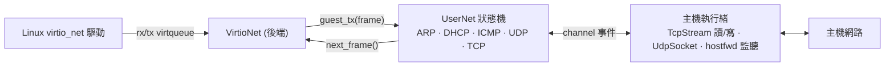

# ruvm v0.9：網路

兩種架構的 Linux 現在都有網路：virtio-net 裝置 + 完全在使用者空間實作的網路堆疊（不需要 root、TAP 或任何函式庫）。

```
$ ruvm -M aarch64 ... -nic user,hostfwd=tcp::2222-:22
~ # udhcpc -i eth0 -n -q -s /etc/udhcpc.script      # DHCP: 10.0.2.15
~ # nslookup example.com                            # DNS 轉送到主機的解析器
~ # wget -q -O - http://example.com                 # 真實網際網路上的 TCP
```

## 虛擬網路

| 位址 | 角色 |
|---|---|
| `10.0.2.15` | 客體（DHCP 租約） |
| `10.0.2.2` | 閘道，**同時是主機**：連到它的 TCP/UDP 會被轉成連到主機的 `127.0.0.1` |
| `10.0.2.3` | DNS：轉送給主機 `/etc/resolv.conf` 的第一個 nameserver（預設 8.8.8.8） |

## 元件



* `src/virtio/net.rs`：兩個佇列（0 = 接收、1 = 傳送）。特性只有 MAC 與 STATUS（沒有 checksum/TSO 卸載，
  所以客體送出的是一般的 MTU 大小乙太網路框）。VERSION_1 下每個封包前有 12 位元組標頭。
  接收：驅動預先放好空的緩衝區，後端在 `NotReady` 時把它們留著，有封包時才填入並完成。
* `src/net/proto.rs`：乙太網路 / IPv4 / UDP / TCP 編解碼、網際網路 checksum。
* `src/net/mod.rs`：`UserNet`——純粹的狀態機，由 `guest_tx` 與 `next_frame` 驅動，所有協定邏輯都在模擬器執行緒；
  主機端的 socket 在輔助執行緒，透過 channel 傳事件。

### TCP

每個客體連線對應一個主機 `TcpStream`。對客體而言我們是一個真正的 TCP 端點：

* 序號追蹤（`rcv_nxt`、`snd_nxt`、`snd_una`）、重複／重傳段修剪、對客體視窗的流量控制（MSS 1460，不用視窗縮放）、FIN/RST、
  主機端連線失敗回 RST。
* 主機資料先進 `pending`，依客體視窗送出；客體在主機連線完成前送來的資料先暫存。
* 虛擬鏈路不會掉包，所以不做重傳計時器；客體自己的重傳由「立即 ACK」處理。
* `hostfwd=tcp::HOST-:GUEST`：主機監聽 `127.0.0.1:HOST`，每個連入的連線由堆疊對客體主動開連線（SYN → SYN-ACK → ACK）。
  監聽 socket 只建立一次，重開機後仍可使用。

### 其他

* **ARP**：回應閘道與 DNS。**DHCP**：DISCOVER→OFFER、REQUEST→ACK（租約 24 小時，含 mask / router / DNS / broadcast）。
* **ICMP**：只回應對閘道與 DNS 的 echo（不假裝能 ping 外部）。
* **UDP**：每個 (客體埠, 目的地) 對應一個主機 `UdpSocket`，回應的來源位址改寫成原本的目的地。

## 與時間的關係

有網路裝置時，`WFI` 閒置**改成真實時間等待**，不再把客體時鐘快轉到下一個計時器（外部事件隨時可能到達；
否則 `wget -T 10` 這類逾時會立刻過期）。沒有網路裝置時仍然快轉，所以沒有 `-nic` 的測試一樣快。

## 測試

* 單元測試（`src/net/mod.rs`）：ARP、ICMP echo、UDP 往返、TCP 連線／資料／主機端關閉。
* `linux_user_network_{riscv64,aarch64}`（`--ignored`）：客體取得 DHCP 租約、ping 閘道、
  用 `wget` 抓主機 HTTP 伺服器、用 `tftp` 對主機 UDP 伺服器讀檔、並接受主機透過 `hostfwd` 開的連線。
* 手動：ARM 客體 `nslookup example.com` 與 `wget http://example.com` 對真實網際網路成功。
