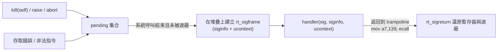

# ruvm v1.1：使用者模式（`-user`）

類似 `spike pk` / `qemu-user`：直接執行**一個**靜態連結的 Linux ELF，不需要核心、不需要磁碟映像。
程式的系統呼叫（RISC-V `ecall`、AArch64 `svc #0`）由主機代為處理。

```
ruvm -user hello.elf [參數...]          # 架構由 ELF 判斷，也可加 -M
```


## 做法

* 記憶體是從 64 KiB（`0x1_0000`）開始的一整塊 RAM（預設 1 GiB，`-m` 可改，向主機要的是未觸碰的虛擬記憶體）：程式在連結位址、
  `brk` 堆積在其上、`mmap` 區域從堆疊下方往下長、堆疊在最上面（8 MiB）。static-pie 載入在 `0x1000_0000`。
* 堆疊依 Linux 的慣例建好：`argc`、`argv`、`envp`（沿用主機環境）、auxv（`AT_PHDR/PHENT/PHNUM/PAGESZ/ENTRY/RANDOM/HWCAP/EXECFN…`）。
* CPU 以 M-mode 且無 MMU 執行（RISC-V 先開 `mstatus.FS`），所以沒有分頁的額外開銷。
* 兩種架構共用 asm-generic 系統呼叫編號，一份實作（[`src/linux.rs`](../src/linux.rs)）。

## 支援的系統呼叫

| 類別 | 呼叫 |
|---|---|
| 行程 | `clone`（fork 語意，或 `CLONE_THREAD` 建立執行緒）, `futex`（WAIT/WAKE/REQUEUE/CMP_REQUEUE/WAKE_OP/BITSET）, `sched_yield`, `execve`, `wait4`, `exit`, `exit_group`, `getpid/gettid/getuid…`, `set_tid_address`, `prlimit64`, `uname`, `kill/tkill/tgkill`、`rt_sigaction`、`rt_sigprocmask`、`rt_sigpending`、`rt_sigreturn` |
| 檔案 | `statx`, `pipe2`（主機管線）, `renameat/renameat2`, `symlinkat`, `linkat`, `chdir/fchdir`, `truncate/ftruncate`, `fsync`, `statfs`, `pselect6`, `openat`, `close`, `read/write`, `readv/writev`, `pread64/pwrite64`, `lseek`, `fstat`, `newfstatat`, `faccessat`, `getdents64`, `readlinkat`, `getcwd`, `mkdirat`, `unlinkat`, `dup/dup3`, `fcntl`, `ioctl`（一律 ENOTTY）, `ppoll` |
| 記憶體 | `brk`, `mmap`（匿名與檔案私有映射）, `munmap`, `mremap`, `mprotect`/`madvise`（無作用） |
| 時間 | `clock_gettime`, `gettimeofday`, `nanosleep`, `clock_nanosleep` |
| 其他 | `sysinfo`, `sched_getaffinity`, `getrandom`, `futex`（單執行緒）, 訊號相關呼叫（回傳 0，不遞送） |

`RUVM_STRACE=1` 會把每個系統呼叫印到 stderr。未知的呼叫回傳 `ENOSYS`。主機的 errno 會換成 Linux 的編號。

## 動態連結

```
tools/linux/fetch-sysroot.sh                       # Debian 的 libc6 + dash（riscv64 與 arm64）
ruvm -L tests/guest/out/user/arm64/sysroot -user tests/guest/out/user/arm64/sysroot/usr/bin/dash -c 'echo hi'
```

* 程式有 `PT_INTERP` 時，載入器從 sysroot 讀取動態載入器（`ld-linux-*.so`），放在記憶體高處（mmap 區域上緣），
  把 `AT_BASE` 設成它的位址，並從它的進入點開始執行；函式庫由 `ld.so` 自己用 `openat` + `mmap`（先保留整段、再用 `MAP_FIXED` 覆蓋）載入。
  PIE 主程式載入在 `0x1000_0000`。
* `-L <dir>`：程式用到的絕對路徑，若在 `<dir>` 下也存在就改用那一份（`openat`、`stat`、`execve`、`readlink`… 全部一致），否則維持主機路徑；
  所以 `/lib/ld-linux-aarch64.so.1`、`/lib/aarch64-linux-gnu/libc.so.6`、`/bin/sh` 都落在 sysroot，`/tmp` 等仍是主機的。
  sysroot 內的相對符號連結照常解析；指向絕對路徑的符號連結會離開 sysroot。
* 沒有給 `-L` 時，動態連結的程式會得到明確的錯誤訊息。

## 執行緒

`clone(CLONE_VM|CLONE_THREAD|…)` 在同一份記憶體上多開一個模擬 CPU（與 `-smp` 相同的輪流排程）：新 CPU 複製呼叫者的暫存器，
`a0` 回傳 0、換上新堆疊與 `CLONE_SETTLS` 指定的執行緒指標；檔案描述符、`brk`/`mmap`、訊號處理設定由所有執行緒共用。

* `futex` 的等待會讓該執行緒進入阻塞狀態，`FUTEX_WAKE`/`REQUEUE`/`WAKE_OP` 讓它們繼續；逾時（相對與絕對）由排程器處理，
  全部執行緒都阻塞時模擬器會睡到最早的逾時，沒有逾時可等就回報 `deadlock`。
* `exit` 只結束呼叫的執行緒（`CLONE_CHILD_CLEARTID` 的位址清零並喚醒 joiner），最後一個執行緒離開或 `exit_group` 才結束行程；
  `nanosleep` 在有其他執行緒時只阻塞自己。
* `fork` 的子行程只有呼叫的那個執行緒；`execve` 會結束其他所有執行緒。
* 原子指令靠現有 SMP 的實作；因為輪流排程是確定性的，競爭條件的結果可重現。

## 訊號



* 訊框是 Linux 的 `rt_sigframe` 格式（siginfo、ucontext、通用暫存器；兩種架構各自的 `mcontext` 布局），所以 libc 與常見程式能照常運作。
  浮點暫存器不存（同步訊號下呼叫者本來就不期待它們被保留）。
* 預設動作：多數訊號結束程式（狀態 128+sig）；`SIGCHLD/SIGCONT/SIGURG/SIGWINCH` 與停止類訊號忽略。`SIGKILL` 永遠結束程式。
* 支援 `SA_NODEFER`、`SA_RESETHAND` 與 `sa_mask`；`execve` 後忽略的訊號與遮蔽集合保留，handler 重設。
* 返回用的 trampoline 由 ruvm 放在堆疊下方（`mov a7,139; ecall` / `mov x8,#139; svc #0`），libc 不用提供 `sa_restorer`。

## 限制

* 執行緒最多 256 個，在同一個主機執行緒上輪流執行（確定性排程），不會用到多個主機核心。
* 訊號只做「同步」的部分：行程對自己 `kill`/`raise`/`abort`，以及指令錯誤造成的 SIGSEGV/SIGILL。
  沒有非同步訊號：`alarm`、`setitimer`、`SIGCHLD`（子行程結束不會通知父行程）、`SIGINT` 等不會打斷程式；`sigaltstack` 不作用
  （handler 在目前的堆疊上跑，所以堆疊溢位的 SEGV handler 無法運作）；`sigsuspend`/`pause` 直接回傳 `EINTR`。
* 低 64 KiB 不映射：空指標存取會讓程式以狀態 139 結束（印出 `Segmentation fault`）。其餘沒有記憶體保護，`mprotect` 不作用。
* `fork` 的做法：直接 `fork()` 主機的 ruvm 行程。整個模擬器狀態（記憶體、暫存器、檔案描述符）由作業系統以 copy-on-write
  複製，所以語意完全正確，也不需要自己維護行程表；子行程是獨立的主機行程，`wait4` 就是 `waitpid`，`pipe2` 是真的主機管線。
  `vfork`/`CLONE_VM` 也當成 `fork` 處理（子行程不與父行程共用記憶體）。`clone` 的 child stack 參數有支援。
* `execve`：先在新的記憶體映像中載入程式（失敗時可把錯誤回報給呼叫者），成功後整個映像與 CPU 換掉，保留未設 `O_CLOEXEC` 的描述符。
  支援 `#!` 腳本。不是此架構的 ELF（例如主機上 PATH 找到的 Mach-O 程式）回傳 `ENOENT`，讓 shell 繼續找下一個。
* 子行程被訊號殺死時，`wait4` 的狀態是主機的訊號編號（Linux 與 macOS 在常見訊號上一致）。

## 驗證

* `user_mode_freestanding_program`：`tests/guest/user_hello.c`（無 libc，只用 syscall）在兩種架構上輸出完全相同的內容：
  argv、auxv、`brk`、`mmap`、浮點、讀自己的 ELF、`uname`、時鐘、管線、`dup`/`fcntl`、`statx`、`chdir`、`rename`、`ENOSYS`、結束碼。
* `user_mode_dynamic_linking`（`fetch-sysroot.sh`）：動態連結的 `dash`（glibc）在兩種架構上跑腳本，含管線（fork）與 `execve` 另一個動態程式，並檢查沒有 `-L` 時的錯誤訊息。
* 同一支程式也測執行緒（`clone`、原子計數、futex 喚醒、join、逾時）。
* 也手動驗證了 Rust `std` 的 `thread::spawn`/`Mutex`/`mpsc`/`Condvar`/`sleep`（`aarch64-unknown-linux-musl`）。
* 同一支程式也測訊號：handler、遮蔽與解除遮蔽、忽略、預設動作（SIGTERM → 143）、SIGSEGV handler。
* 同一支程式也測 `fork` + 管線 + `wait4` 狀態、`fork` + `execve`（`/proc/self/exe`）、找不到檔案、沒有子行程。
* `user_mode_null_pointer_faults`：空指標存取以 139 結束。
* `user_mode_busybox`（`tools/linux/fetch-busybox.sh` 取得 Debian 的靜態 busybox，glibc）：`echo`、`tr`（管線）、
  `sha256sum`（與主機 `shasum` 比對）、`uname`、結束碼，以及 `busybox sh -c`（fork、execve、管線、重導、`$?`、`trap` + `kill`），兩種架構。
* 也手動驗證了 Rust `std` 程式（`aarch64-unknown-linux-musl`：HashMap、argv、println!）。

## 自己編譯一個程式

```
# AArch64：Rust（std，musl）
rustc --target aarch64-unknown-linux-musl -C linker=clang -C link-arg=--target=aarch64-linux-musl -C link-arg=-fuse-ld=lld hello.rs
# 任一架構：C 加上自己的 libc 或 -nostdlib（見 tests/guest/user_hello.c、tests/guest/build_user.sh）
# 有交叉工具鏈時：riscv64-linux-gnu-gcc -static hello.c -o hello.elf
ruvm -user hello.elf
```
