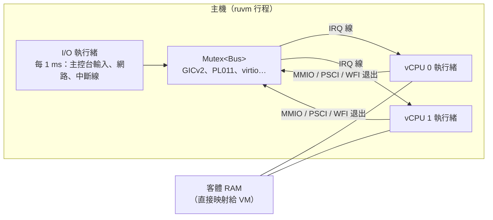

# ruvm v1.2：硬體虛擬化（`-accel hvf` / `-accel kvm`）

在 AArch64 主機上跑 AArch64 客體時，客體的指令可以直接在主機 CPU 上執行，不必逐條直譯。
macOS（Apple silicon）用 Hypervisor.framework，Linux 用 KVM。ruvm 只處理裝置存取：
板子和直譯器時完全一樣（RAM、GICv2、PL011、PL031、virtio-mmio、PSCI），所以同一個核心、同一個磁碟映像不必改。

```
tools/hvf-sign.sh                                   # macOS：每次編譯後簽章一次
ruvm -M aarch64 -m 1024 -smp 4 -accel hvf -kernel linux -initrd initramfs.cpio.gz \
     -drive file=root.ext4 -append "console=ttyAMA0 rdinit=/init"
```

`-accel tcg`（預設）是原本的直譯器。RISC-V 客體、x86 主機、`-user`、`-icount` 都只能用直譯器。



## 速度

同一台 M3 iMac，Debian 13 的 arm64 核心（6.12）：

| 工作 | 直譯器（`tcg`） | `hvf` |
|---|---|---|
| ext4 根目錄開機、重開機、再開機（`linux_ext4_root_reboot_aarch64`） | 23.8 秒 | 1.6 秒 |
| 4 CPU 開機、4 個背景工作、關機（`linux_smp_aarch64`） | 14.1 秒 | 0.9 秒 |
| [rubrowser](https://github.com/ccc-claude-opus/rubrowser) 的 Debian 13 測試：開機、兩個網頁截圖（含 wasmtime JIT）、關機 | 11 分 35 秒 | 6 秒（1 CPU）、2–4 秒（4 CPU） |

客體程式碼以原生速度執行，剩下的時間主要花在 MMIO 退出（每次幾微秒）與主機上的裝置模擬。

## 做法

* **RAM**：`Bus` 的 RAM 改成 64 KiB 對齊的配置（`bus::Ram`），整塊用 `hv_vm_map` / `KVM_SET_USER_MEMORY_REGION` 映射進 VM，
  客體存取 RAM 不會退出；碰到 RAM 以外的位址才會退出到 ruvm。
* **執行緒**：每個 vCPU 一條主機執行緒（Hypervisor.framework 規定 vCPU 屬於建立它的執行緒），
  加一條 I/O 執行緒。`Bus` 放在 `Mutex` 裡，退出時才鎖。所以 `-smp 4` 真的同時用 4 個核心。
* **MMIO**：HVF 的資料中止（EC 0x24）從 ESR 的 ISV / SAS / SSE / SRT / SF / WnR 解出大小、方向與暫存器；
  KVM 直接給 `KVM_EXIT_MMIO`。兩者都交給 `Bus::read` / `Bus::write`，也就是直譯器用的同一組裝置。
* **中斷**：GICv2 仍是 ruvm 的模型（[`src/gic.rs`](../src/gic.rs)），它算出每個 CPU 的 IRQ 線。
  KVM 用 `KVM_IRQ_LINE` 直接設定（vCPU 執行中也可以）。HVF 只能在進入客體前用 `hv_vcpu_set_pending_interrupt` 設定，
  所以 IRQ 線升起、而該 vCPU 還不知道時，用 `hv_vcpus_exit` 把它踢出來重新進入。
* **計時器**：客體的 EL1 虛擬計時器（PPI 27）。HVF 在計時器觸發時退出（`VTIMER_ACTIVATED`）並自動遮罩，
  ruvm 把 PPI 27 拉高，等客體處理完（`CNTV_CTL` 不再是 ENABLE+ISTATUS）才解除遮罩。
  KVM 沒有核心內的 GIC 時，把計時器輸出放在 `kvm_run.s.regs.device_irq_level`（`KVM_CAP_ARM_USER_IRQ`），每次退出時同步。
  虛擬計數器從 0 開始（HVF 的 vtimer offset 取 `mach_absolute_time()`：它和 EL0 讀到的 `CNTVCT_EL0` 差一個常數，不能混用）。
* **WFI**：HVF 會退出，ruvm 睡到 IRQ 線升起或計時器的期限（`CNTV_CVAL`）；KVM 在核心裡處理。
* **PSCI**：HVF 的 HVC 退出交給 [`src/psci.rs`](../src/psci.rs)（從直譯器抽出來共用）：CPU_ON 叫醒等待中的 vCPU 執行緒，
  CPU_OFF 讓它回去等。KVM 用核心內的 PSCI 0.2，次要 vCPU 以 `KVM_ARM_VCPU_POWER_OFF` 建立；SYSTEM_OFF / RESET 以系統事件回報。
* **其他陷入**：HVF 會把除錯、PMU 等系統暫存器的存取丟回來，讀為 0、寫入忽略。
* **重開機**：`Stop::Reset` 後 `Machine::reset` 重建板子，下一次 `run` 建立新的 VM。
* **時間**：客體時間就是真實時間，不再是「每條指令一格」；所以 `-icount` 和可重現性只有直譯器有。

## 真正並行之後修掉的兩個問題

直譯器裡所有事情都在同一條執行緒上依序發生；換成硬體之後，客體驅動程式和 ruvm 的裝置在不同核心上同時執行，暴露出兩個問題：

1. **virtqueue 的記憶體順序**：virtio 裝置在 `poll()` 裡處理佇列，而 I/O 執行緒會在客體寫佇列的同時呼叫它。
   讀到新的 avail idx 後必須有 acquire 屏障才讀描述符，寫 used idx 前要有 release 屏障
   （[`src/virtio/mod.rs`](../src/virtio/mod.rs)），否則可能讀到舊的描述符。
2. **邊緣觸發中斷的遺失**：virtio-mmio 的中斷是邊緣觸發。客體寫 InterruptACK 讓線降下，同一次 `poll_irqs` 裡裝置又完成了新的請求，
   線立刻又升起，GIC 看不到降下再升起，於是沒有新的 pending，4 個 CPU 一起睡在 WFI。
   現在 `Bus::poll_irqs` 在裝置 `poll()` 前後各取樣一次。

## 測試

* `cargo test --release -- --ignored _hvf`（macOS / Apple silicon）：ext4 開機與重開機、使用者模式網路（DHCP、HTTP、UDP、hostfwd）、4 CPU SMP，
  和直譯器版本是同一組檢查。測試會把 ruvm 複製一份並簽章，所以不必先跑 `tools/hvf-sign.sh`。
* [`tools/linux/kvm-test.sh`](../tools/linux/kvm-test.sh)：在沒有 KVM 的機器上（例如 Mac 的 Docker）測 `-accel kvm`。
  Docker 裡的 `qemu-system-aarch64 -M virt,virtualization=on` 模擬出有 EL2 的機器，Debian 核心在 EL2 開機後就有 `/dev/kvm`，
  再用 `ruvm -accel kvm` 開機測試用的 Linux（ext4、重開機、2 vCPU）。全部是模擬的，在 M3 iMac 上約 33 秒（不含第一次建 Docker 映像）。

## 簽章（macOS）

Hypervisor.framework 只讓帶有 `com.apple.security.hypervisor` entitlement 的程式使用。
[`tools/hvf-sign.sh`](../tools/hvf-sign.sh) 用 ad-hoc 簽章（`codesign --sign -`）加上 [`tools/hvf.entitlements`](../tools/hvf.entitlements)，
不需要開發者帳號或 sudo。`cargo build` 重新連結後簽章會消失，要再簽一次；沒簽時 ruvm 會說明要怎麼做。
